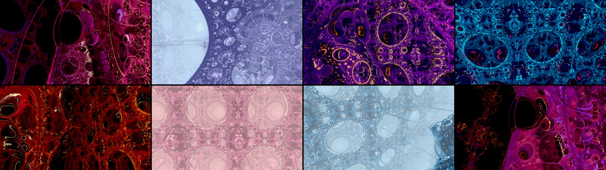

# Fractal Drift

A real-time music visualizer: you fly through infinite 3D fractals that react to whatever Spotify is playing. You can steer with a PS5 DualSense, the keyboard and mouse, or touch.



## Run it (Surface Pro 11 or any Windows PC)

1. Copy this whole `musicvis` folder to the Surface.
2. Double-click **`Start Fractal Drift.bat`**. Edge opens in a borderless window. There's nothing to install; it uses only built-in Windows PowerShell and Edge.
3. Click **Listen to Spotify (system audio)**. In the share picker, choose **Entire screen** and turn on **"Also share system audio"**.
4. Play music in the Spotify app (or the web player). Press **G** for fullscreen.

Other audio sources: a microphone or line-in (including Stereo Mix or a virtual cable), the built-in **Demo beat**, or **Just explore** with no audio.

> Why system audio and not the Spotify API? Spotify removed the audio-analysis/features endpoints for new apps in late 2024, so the app listens to the actual sound and runs its own FFT, band analysis and beat detection. A side benefit is that it works with any audio source, not just Spotify.

## PS5 DualSense

Connect it over USB-C or Bluetooth (*Settings → Bluetooth → Add device*, then hold **PS + Create** until the light flashes). Press any button once the page is open.

| Control | Action |
|---|---|
| Left stick | Up/down is the throttle (centred you drift on gently, back brakes). Left/right **rolls** |
| Right stick | Steer - you go where you point, with a lean into the turn for feel |
| R2 / L2 (analog) | Boost / brake |
| L1 / R1 | Previous / next tab |
| D-pad ← → | Previous / next fractal |
| D-pad ↑ ↓ | Morph the fractal's shape live |
| ✕ | Autopilot on/off. With it off, autopilot still engages by itself after 20 s without input; move a stick to take over. (it steers toward open space and its speed follows the music; the sticks still work) |
| □ | Cycle colour palette (borrow another scene's palette) |
| △ | Hide/show HUD |
| ◯ | Reset view |
| Touchpad click | Cycle audio reactivity (Off → Insane) |
| L3 | Photo mode (max detail; hold still and the image refines) |
| R3 | Level the horizon |
| Create | Screenshot to Downloads |
| Options | Settings menu (D-pad navigates, ✕ changes, ◯ closes) |

The controller rumbles like a bass transducer (a Woojer strap or Crusher headphones): the heavy motor follows the low-passed waveform itself, so you feel the *shape* of the bass - each kick's thump and every wobble of a bassline - instead of a smeared level meter. Quiet passages stay quiet, hats and vocals do not move it, and the light motor only adds the attack snap. Strength is *Off / Light / Normal / Strong* in Settings, and changing it buzzes the controller so you can feel the level.

Over **Bluetooth** the browser cannot drive a DualSense's motors at all through the normal gamepad route, so rumble goes dead. Fix it once with *Settings › Direct haptics › Connect* (click it with the mouse - a controller button cannot grant the permission), pick the controller in the browser's dialog, and it talks to the pad directly over both Bluetooth and USB. The choice is remembered for next time. Flight speed scales with your distance to the surface, so you can keep diving into smaller and smaller detail without hitting anything.

**Flying.** The default **Drift** model is built to be calm and forgiving: you go where you point (the stick aims the nose directly), the craft leans gently into its turns for feel, and you keep drifting forward with the stick centred instead of stopping dead. Roll is on the left stick and nothing levels it for you - a fractal has no up, so the horizon stays wherever you put it (R3 levels it to the world if you ever want that). It eases away from walls rather than bumping them, and speed follows the room you have **along the way you are pointing**, not just the nearest surface - so you can shoot a tight gap instead of crawling to a halt in front of it. A scene opens parked on its composed viewpoint - touch the throttle and you are flying. Pull back (or hold L2) to slow almost to a stop.

Two other models in *Settings › Flight model*: **Glide** flies like an aircraft (the bank carves the turn and momentum throws you wide), and **Free cam** is the old spectator camera that strafes anywhere and stops dead (`?free`).

**Keyboard and mouse:** W/S throttle, A/D roll, Q/E slide sideways, Space/C climb and dive, drag or arrow keys to steer, Shift/Ctrl boost/precision, N/B or 1–9 to change fractal, R/F morph, P autopilot, O palette, H HUD, V reactivity, X photo mode, K screenshot, wheel for speed, Esc for settings, G fullscreen.
**Touch:** drag to steer, pinch for the throttle.

## The fractals

Magenta Foam and Fractal Light are the favourites, and most of the list is variations of those two: the same pseudo-Kleinian foam at the same zoom, from different viewpoints and in different palettes. The running order deliberately puts a different shape every third world, so you never get a long run of the same bubbles.

| # | Scene | Shape |
|---|---|---|
| 1 | Magenta Foam | pseudo-Kleinian foam |
| 2 | Fractal Light | pseudo-Kleinian foam |
| 3 | Silver Spires | Menger towers |
| 4 | Orchid Ember | pseudo-Kleinian foam |
| 5 | Abyssal Foam | pseudo-Kleinian foam |
| 6 | Ivory Bulb | Mandelbulb |
| 7 | Pearl Lace | pseudo-Kleinian foam |
| 8 | Violet Drift | pseudo-Kleinian foam |
| 9 | Obsidian Spires | Menger towers |
| 10 | Frost Lace | pseudo-Kleinian foam |
| 11 | Ultraviolet | pseudo-Kleinian foam |
| 12 | Quartz Shards | KIFS crystal |
| 13 | Lilac Mist | pseudo-Kleinian foam |
| 14 | Jade Lace | pseudo-Kleinian foam |
| 15 | Toxic Bloom | Mandelbox |
| 16 | Cobalt Bloom | pseudo-Kleinian foam |
| 17 | Porcelain | pseudo-Kleinian foam |
| 18 | Cathedral | Menger towers |
| 19 | Ruby Haze | pseudo-Kleinian foam |
| 20 | Emerald Deep | pseudo-Kleinian foam |
| 21 | Drift Belt | asteroid field |
| 22 | Mint Glass | pseudo-Kleinian foam |
| 23 | Sunset Foam | pseudo-Kleinian foam |
| 24 | Verdigris Lattice | Menger towers |
| 25 | Copper Veil | pseudo-Kleinian foam |
| 26 | Coral Foam | pseudo-Kleinian foam |
| 27 | Opal Bubbles | Apollonian bubbles |
| 28 | Teal Bubbles | pseudo-Kleinian foam |
| 29 | Rose Reef | pseudo-Kleinian foam |

**Colour flow** (Settings): on by default, so the marbled colour bands flow with the bass. *Off* switches to a flat whole-scene hue shift instead.

**Quality** (Settings): *Auto* now climbs to **Very high** (finer hit threshold, more march steps) when the GPU has room to spare, which is where spare frame rate should go - it looks the same as High, just sampled finer. *Ultra* is still manual only, because it adds cast shadows and so changes the look. **Target FPS** cycles 30/60/90/120: raise it if you have a high-refresh display and would rather spend the headroom on frame rate than on detail.

**Output resolution** (Settings): *Auto* caps the output at 1600 px wide on integrated GPUs (Surface, Intel) and 2560 px on gaming GPUs. Lower it for smoother full screen on the Surface, or raise it on a desktop GPU.

**Music response (tuned for bass-heavy music):** the fractal's shape never moves with the music, so the image stays sharp. Instead:
- **Bass and wobbles:** colours flow along the bands, and the rims glow and swell.
- **Sub-bass:** rings ripple outward through the structure.
- **Kicks:** an extra push of the colour flow.
- **Hi-hats and snares:** a small glint on the surfaces.

The autopilot's speed only changes slightly with the music. Use the touchpad click (or V) to set the overall reactivity.

## Tabs

**L1 / R1** (or `,` and `.`) move between tabs; the arrows still move between the scenes inside the current tab, and each tab remembers where you were.

| Tab | What it is |
|---|---|
| **Fractals** | The 29 worlds above - the raymarched fractals |
| **Canyon** | Endless ridged terrain under a sky: an open, exterior world instead of an interior |

Canyon is raymarched like the fractals, so everything (autopilot, palettes, colour flow, photo mode) works there too.

## Performance tips (important on a Surface)

- **Always start it with `Start Fractal Drift.bat`.** That opens an Edge app window asking Windows for the discrete GPU. Opening `localhost:8765` yourself in an ordinary Chrome/Edge tab can land on the integrated Intel chip instead, which roughly halves the frame rate. Check the GPU line with `?stats` (or Settings › Show stats) - it names the GPU actually in use, and the app warns you on startup if it is an integrated one.
- If it still picks the wrong GPU, set it per-app in Windows: *Settings → System → Display → Graphics*, add `msedge.exe`, set it to **High performance**.
- **Plug in** and set *Settings → System → Power → Power mode* to **Best performance**. On battery, Windows throttles the GPU to about half speed. The app shows a warning when it detects battery power.
- In Edge, turn off *Settings → System and performance → Efficiency mode*, or exclude this page from it.
- If it still stutters, open Settings in the app and set **Target FPS to 30**, or set **Quality to Medium**.

## Files

```
index.html          UI shell (start screen, HUD, settings, help)
js/shaders.js       raymarcher, lighting, temporal upsampling, bloom, tonemapping (GLSL)
js/fractals.js      distance estimators + art direction for each scene (palettes, lights)
js/tabs.js          the tab list and the Canyon scenes
js/renderer.js      WebGL2 passes, dynamic resolution, async GPU probe readback
js/audio.js         system-audio / mic capture, band analysis, beat detection, demo beat
js/input.js         DualSense (standard + raw Bluetooth mappings), keyboard, mouse, touch
js/flight.js        drift / glide / free-cam flight models, collision, music-driven autopilot
js/main.js          app loop and settings
tools/serve.ps1     zero-install localhost server used by the .bat launcher
tools/devserver.js  dev server (Node) with a /shot endpoint for capturing comparison frames
```

URL options for tinkering: `?scene=3`, `?demo`, `?go` (skip the start screen), `?stats`, `?q=high|ultra`, `?auto=0`, `?free` (spectator camera).

To add a scene, add an entry to `scenes` in `js/fractals.js` (pick a `program`, parameters, palette and lights). For another variation of the foam, `foam(name, cam, opts)` builds one from either the Magenta Foam (dark, emissive rims) or Fractal Light (`bright: true`) treatment, and `node tools/scout-cams.js [count] [seed]` prints fresh viewpoints that are checked against the real distance field for a full, layered frame.

## License

[MIT](LICENSE)
